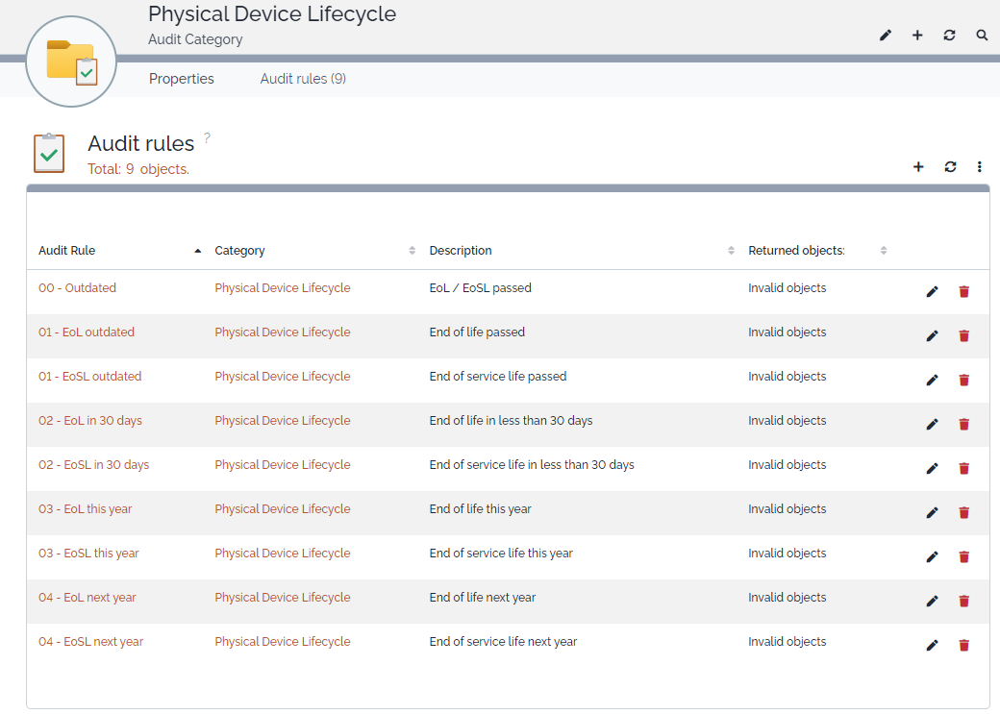

# iTop-br-lifecycle

Copyright (c) 2023-2026 Björn Rudner

## What?

Life Cycle Management of Devices, Brands, OS, etc.

## Upgrading integrations to 3.3.0

Two attributes are deprecated and scheduled for removal from the iTop data
model in a later release. Update saved OQL queries, exports, imports and API
clients to use the native fields.

| Deprecated attribute | Use from 3.3.0 | Meaning |
| --- | --- | --- |
| `Model.eosl` | `Model.end_of_support` | End of model support |
| `OSVersion.eomss` | `OSVersion.end_of_support` | End of mainstream OS support |

Setup migrates these dates once during the upgrade. Later writes to a legacy
field do not update the native date. Continue to use `OSVersion.eol` for the
end of extended support and `OSVersion.eoesu` for the end of security updates.

## How?

### Class: OS Version

The OS version form, default search and summary show three milestones in order:

* End of mainstream support (the native `end_of_support` field)
* End of extended support / End of Life (`eol`)
* End of Extended Security Updates (`eoesu`)

The date section on each linked server, PC and virtual machine displays all
three dates in the same order. Edit them on the OS version; the device forms
read the dates through their existing OS version link.

Open **Devices using this OS version** on a saved OS version to see its servers,
virtual machines and PCs in one list. The list includes devices linked to this
version regardless of their support dates. It shows device types available in
your installation that you have permission to read.

#### Upgrading OS version dates

On upgrade from a version before 3.3.0, setup copies a populated `OSVersion.eomss`
to an empty `OSVersion.end_of_support`. If both contain dates, setup keeps the
native date and logs the OS version ID and both values, even if they are equal.
The legacy `eomss` attribute retains its data and is hidden from the form.
Maintain extended support (`eol`) and extended security updates (`eoesu`)
separately. Each may depend on additional coverage. When the mainstream date
is unknown, setup leaves an empty native date empty.

In each of the server, virtual machine and PC OS lifecycle audit categories,
setup updates **00 - Outdated** and the four **EoMSS** rules by exact name.
The four EoMSS rules use the native date; the combined rule checks all three
milestones. Renaming a rule before upgrading preserves its custom OQL.
A matching rule keeps its ID, owner and other settings when its query is updated.

### Class: Model

Edit **End of Life** on the model, directly below iTop's **End of support**.
Physical devices that display their model's support date show the model's
end-of-life date immediately below it. Both device fields read from the linked model.

Open the model's **Physical devices** tab to see all devices linked to that
model, even when its support date is empty. iTop 3.3 provides this list for
all installed subclasses of `PhysicalDevice` through their `model_id` field.

For models and OS versions, the default results list shows **End of support**
as its lifecycle date. You can add the other lifecycle dates as columns in
your list settings or use them as search criteria.

#### Upgrading model lifecycle dates

When iTop setup upgrades an installed version of `br-lifecycle` older than
3.3.0, the installer copies each populated `Model.eosl` into an empty
`Model.end_of_support`. If both dates are set, even to the same value, setup
keeps the native date, logs the model ID and both dates in the setup log, and
continues. Models without a legacy date need no migration.

The legacy `eosl` attribute retains its stored values and is hidden from the
model forms. Use `end_of_support` for subsequent edits. In the
**Physical Device Lifecycle** audit category, setup updates the OQL of
**00 - Outdated** and the four **EoSL** rules (outdated, in 30 days, this year,
next year) in place when their names still match. This also replaces custom
OQL saved under those names. To keep a custom query, rename its rule before
the upgrade. Other rule settings, including the owner, are preserved.

The four EoSL rules now check `Model.end_of_support`. The combined rule
reports devices whose model has passed either `eol` or `end_of_support`.

### Audit rules

Setup creates lifecycle audits for the device classes installed in iTop:

* Physical Devices
  * EoL/EoSL passed
  * EoL/EoSL within 30 days
  * EoL/EoSL this year
  * EoL/EoSL next year
* Servers
  * EoMSS/EoL/EoESU passed
  * EoMSS/EoL/EoESU within 30 days
  * EoMSS/EoL/EoESU this year
  * EoMSS/EoL/EoESU next year
* Virtual Machines
  * EoMSS/EoL/EoESU passed
  * EoMSS/EoL/EoESU within 30 days
  * EoMSS/EoL/EoESU this year
  * EoMSS/EoL/EoESU next year
* PCs
  * EoMSS/EoL/EoESU passed
  * EoMSS/EoL/EoESU within 30 days
  * EoMSS/EoL/EoESU this year
  * EoMSS/EoL/EoESU next year

#### Screenshot Audit Rules

## iTop Compatibility

Extension version 3.3.0 requires iTop 3.3.0 or later.

| iTop version | Extension branch |
| --- | --- |
| 3.3.x | [main](https://github.com/rudnerbjoern/iTop-br-lifecycle/tree/main) |
| 3.2.x | [itop/3.2](https://github.com/rudnerbjoern/iTop-br-lifecycle/tree/itop/3.2) |
| 2.7 and 3.1 | [itop/2.7](https://github.com/rudnerbjoern/iTop-br-lifecycle/tree/itop/2.7) |

## Translations

Special thanks to [Konstantin Nikulin](https://github.com/apollo2k4) for providing the Russian translation.

## Attribution
